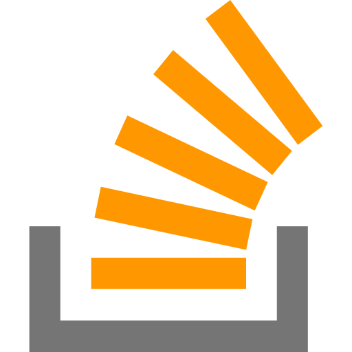

# Hi there! 👋 I'm Chamod Mullegama

I'm a Software Engineer from Sri Lanka 🇱🇰. I enjoy building web applications, working with modern technologies, and solving real-world problems through software.

### What I Do 🚀

- 💻 Develop web applications and software solutions
- ⚙️ Build backend systems and APIs
- 🌐 Create responsive and user-friendly frontend applications
- 🤖 Work with AI and Machine Learning projects
- 🗄️ Design and manage databases
- 🔧 Learn and explore new technologies

### Tech Stack 🛠️

### Connect with Me 📫

Feel free to connect with me for collaborations, software development opportunities, or to discuss technology.

|  |  |  
|---|---|---|---|---|
